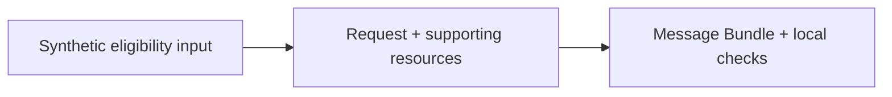

# nphies-eligibility-sample

Build an offline FHIR eligibility message with an NPHIES event and local subset validation.

[](https://github.com/code-rowthtech/nphies-eligibility-sample/actions/workflows/ci.yml)

Educational sample using synthetic data. The badge above reports the actual GitHub Actions status; passing local tests does not imply exchange acceptance or production readiness.

## The problem it solves

Teams need to understand message routing, eligibility requests, coverage references and resource closure before starting Saudi exchange onboarding.

All bundled sample data is invented and synthetic. No real people, production exports, client code or credentials are included. This is a working scoped sample, not a production implementation.

## How it works



Offline only: no request is sent to NPHIES. The builder includes MessageHeader, CoverageEligibilityRequest, Patient, two Organizations and Coverage. Header is first and all resource references resolve inside the bundle. Dates, identifiers, message routing/event and selected request fields are checked. Malformed bundle and entry shapes return validation findings instead of crashing.

Reference reviewed: the public NPHIES Healthcare Financial Services IG Edition 1, version 1.0.0, on 13 November 2026. The validator implements a selected structural subset, not the full IG or payer business rules. The output deliberately does not assert `meta.profile` conformance. Synthetic license/member IDs are not valid production identities. The sample is ready for its documented offline educational scope. Full official-profile validation, exchange-specialist review and sandbox acceptance are separate requirements for a real integration. Do not describe this sample as exchange-accepted.

## Run it in 3 commands

Node.js 22.18+ and npm. TypeScript is executed using native type stripping; `npm run typecheck` runs the separate compiler check. Run these from this repository's directory after cloning/extracting it:

```bash
npm ci --ignore-scripts
npm test
npm start
```

Dependencies may need an initial internet download. Default examples use only bundled synthetic data and local processing. Nothing is sent to a healthcare exchange. Environment templates list names only and contain no values; offline samples need no environment variables.

## Sample input and output

`sample-data/input.json`: synthetic patient/member IDs, provider/payer license placeholders and a service date.

Expected summary (or abbreviated structured output):

```text
{"validForSampleRules":true,"exchangeValidated":false,"resources":6,"output":"output/bundle.json"}
```

Full output examples are under `sample-data/expected-output.json` when applicable. Generated artifacts go to ignored `output/`. Tests cover valid data and meaningful negative cases; the CI workflow runs tests, the demo command, TypeScript checks where relevant, and Gitleaks.

## What we would add in production

Run the official FHIR validator with the exact agreed NPHIES IG package, add all mandatory profile fields/extensions and terminology, validate national/provider IDs, confirm routing/security with onboarding, and test in an authorized sandbox.

## Built by RowthTech

Healthcare software engineering samples, independently written for this portfolio. MIT licensed. Priority: P0; market: GCC.

Primary references consulted on 13 November 2026:

- [https://portal.nphies.sa/ig/artifacts.html](https://portal.nphies.sa/ig/artifacts.html)
- [https://portal.nphies.sa/ig/StructureDefinition-eligibility-request.html](https://portal.nphies.sa/ig/StructureDefinition-eligibility-request.html)
- [https://hl7.org/fhir/R4/bundle.html](https://hl7.org/fhir/R4/bundle.html)

Before public release: clean-clone run, clean Gitleaks scan, second-engineer review, and approval from Mukesh or Raavish. For a real GCC integration, validate against the current authorized exchange guide and complete onboarding/sandbox checks. Those activities are outside this offline sample. No approvals or exchange acceptance are implied by local tests.
